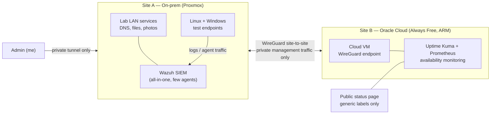

# Architecture

## Design decisions

1. **Availability monitoring lives in the cloud, security analysis lives at home.**
   If the home network fails, the cloud monitor still works and can send the alert. A monitor on the same network it watches cannot do that.
2. **The SIEM runs on-prem, not in the cloud.**
   The cloud free tier (2 OCPU / 12 GB RAM total) cannot fit a SIEM next to everything else. The SIEM vendor's own sizing for a small all-in-one install is 4 vCPU / 8 GiB / 50 GB. The on-prem host can fit that (conditionally — see the project notes), and the endpoint agents work over the tunnel.
3. **Nothing administrative is public.**
   Public exposure is limited to the status page, which uses generic labels. Grafana, the SIEM dashboard, and all management interfaces are reachable only over the private tunnel.
4. **Infrastructure is code.**
   The cloud side is Terraform so it can be reviewed, rebuilt, and torn down reproducibly — not clicked together in a console.
5. **Scope is frozen at three milestones.**
   A working VPN, one diagnosed outage, and one documented security incident are worth more than ten dashboards I cannot explain.
